# SimRacing Championship Manager

Aplikasi web untuk mengelola kejuaraan sim racing, termasuk driver, mobil, sirkuit, jadwal race, peserta, dan hasil. Frontend dibuat dengan React + Vite, sedangkan backend NestJS menyediakan REST API CRUD untuk jadwal race.

## Running

```powershell
npm install
Set-Location backend
npm install
npm run start:dev
```

```powershell
npm run dev
```

## Tahapan dan screenshot

Screenshot instalasi, resource, dan backend berjalan:

1. **Instalasi** — versi Node.js, npm, Nest CLI, dan dependency backend: 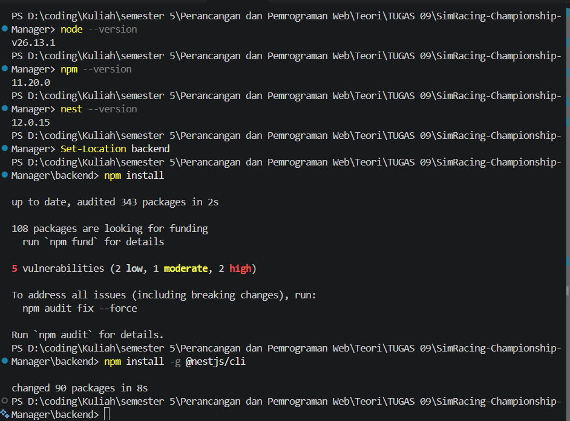.
2. **Resource Race** — struktur entity, DTO, controller, dan service: 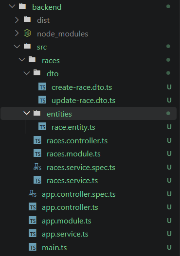.
3. **Backend berjalan** — server NestJS aktif: 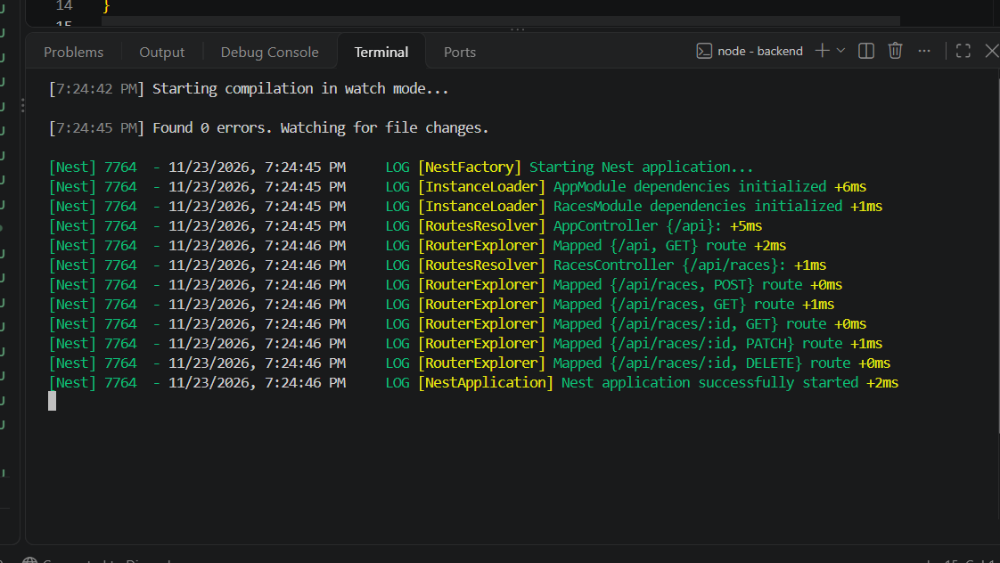.

Request backend diuji pakai REST Client di `backend/test/races.http`.

### 1. Menampilkan daftar race (GET)

Backend mengembalikan seluruh jadwal race dan frontend menampilkan daftar yang sama.

| Backend | Frontend |
| --- | --- |
| 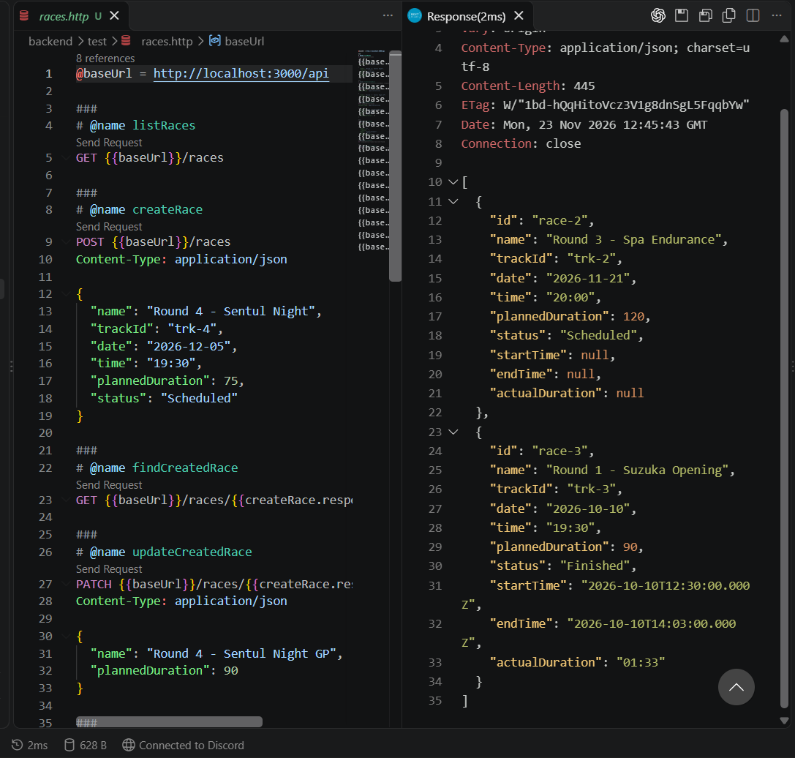 | 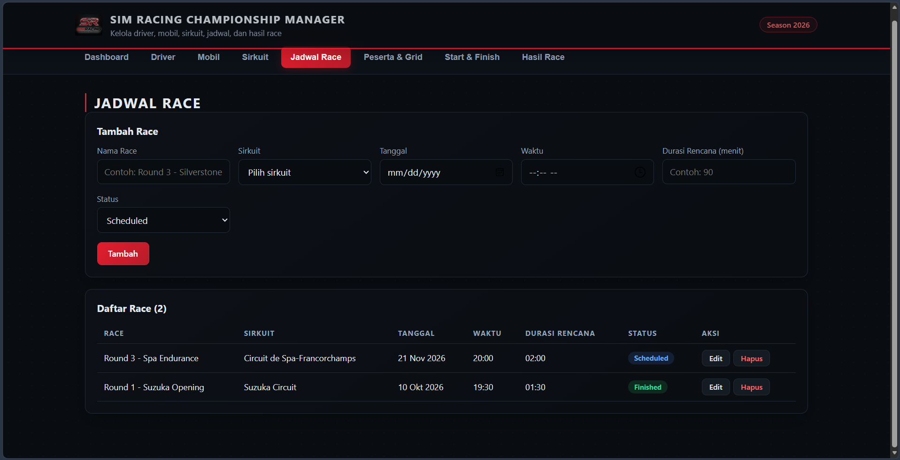 |

### 2. Menambahkan race (POST)

Backend membuat jadwal baru: race/jadwal yang tadi di post akan muncul di daftar frontend. 

| Backend | Frontend |
| --- | --- |
| 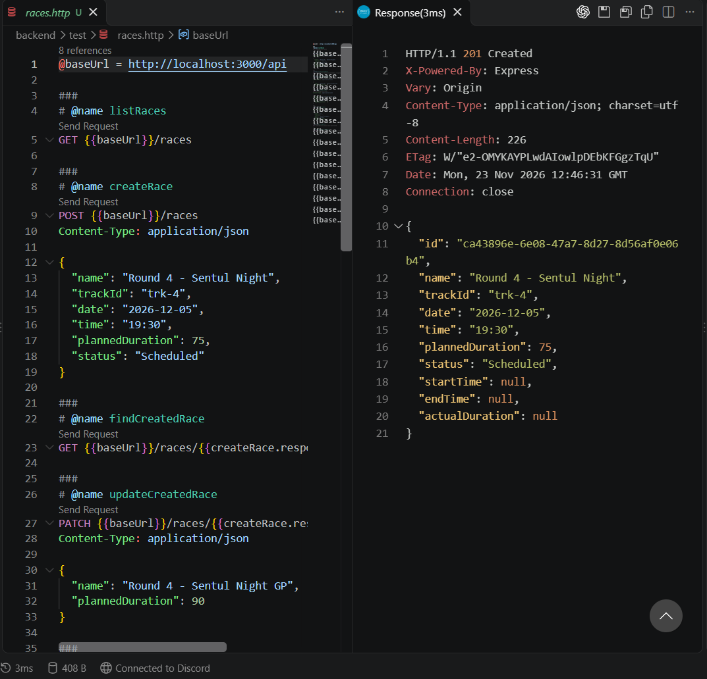 | 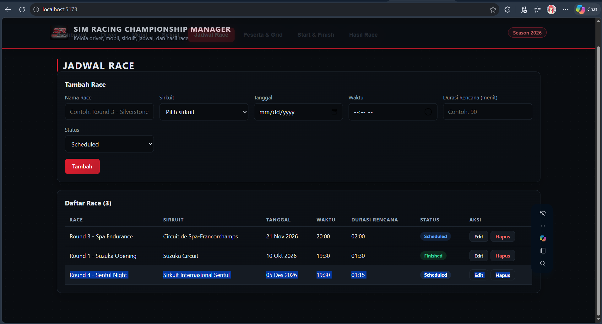 |

### 3. Mengubah race (PATCH)

Backend menyimpan perubahan race dan frontend menampilkan data yang sudah diperbarui.

| Backend | Frontend |
| --- | --- |
| 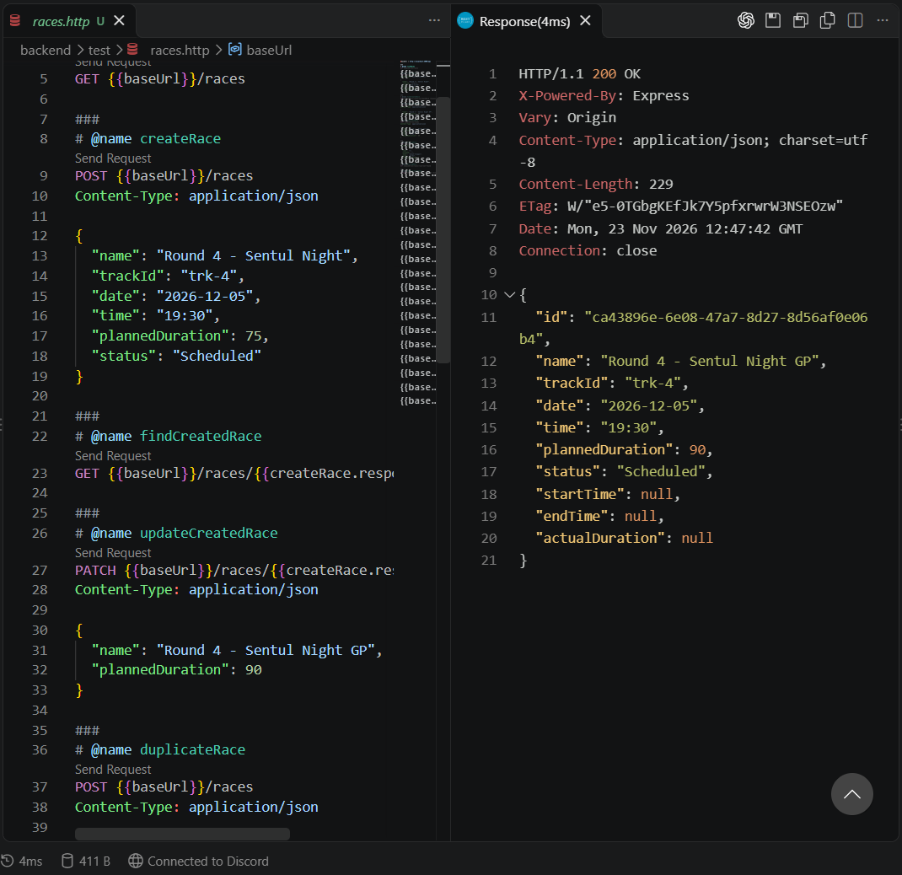 | 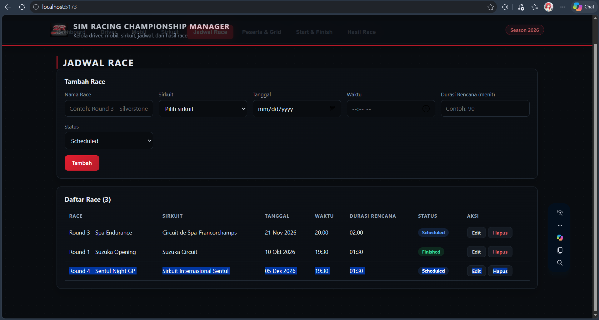 |

### 4. Menghapus race (DELETE)

Backend menghapus race dan frontend memperbarui daftar tanpa race tersebut.

| Backend | Frontend |
| --- | --- |
| 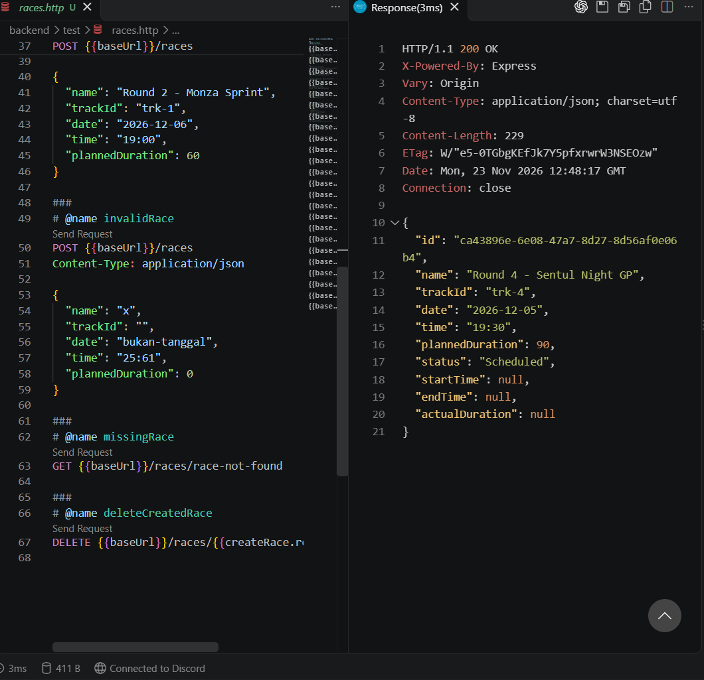 | 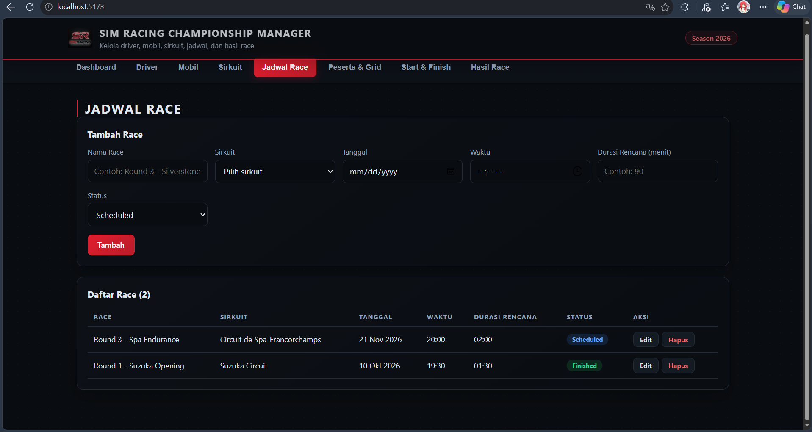 |
